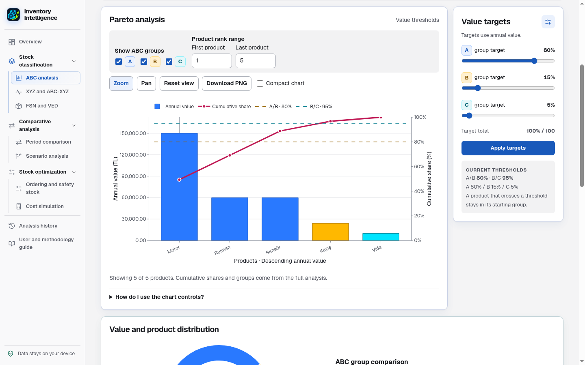
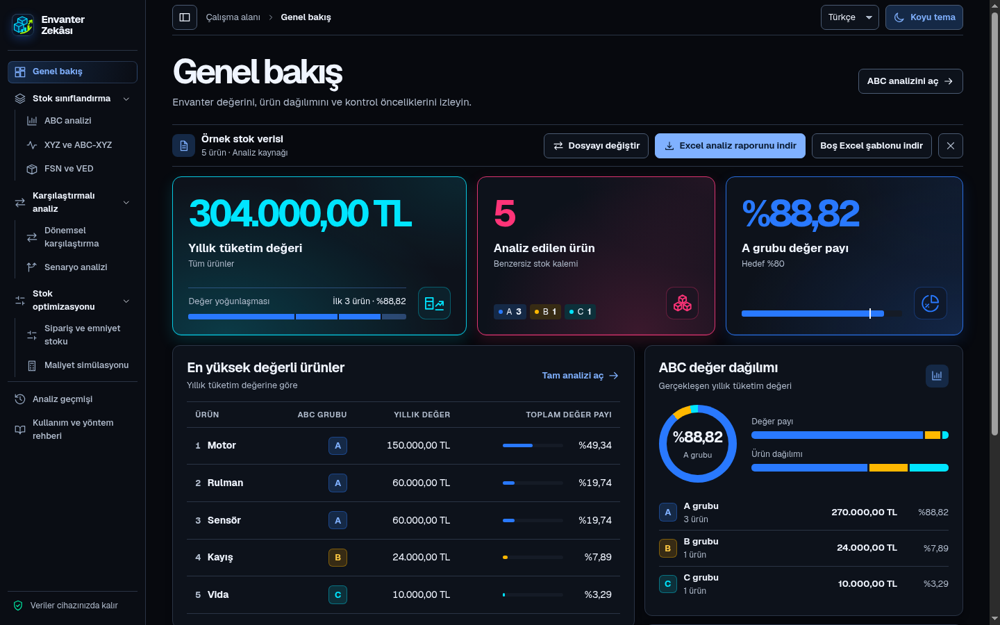

<picture>
  <source media="(prefers-color-scheme: light)" srcset="vercel-app/public/brand-logo-light.svg" />
  
</picture>

# Inventory Intelligence

**Integrated Inventory Decision Support System**

Review inventory value, demand variability, and replenishment policies in your browser. Start with an Excel or CSV file, or open the built-in synthetic example.

[Live application](https://abc-inventory-analysis.vercel.app) · [Türkçe](README.md) · [Technical guide (Turkish)](vercel-app/README.md)
[Full logo](vercel-app/public/brand-logo-full.svg) · [Transparent](vercel-app/public/brand-logo-transparent.svg) · [Light theme](vercel-app/public/brand-logo-light.svg) · [Dark theme](vercel-app/public/brand-logo-dark.svg) · [Favicon](vercel-app/public/favicon.svg)

## Application screenshots





Both screenshots were captured from the local production build with the built-in synthetic example.

## Analysis modules

| Module | What it helps you do |
| --- | --- |
| ABC and Pareto | Rank items by annual usage value and examine class shares and cumulative value. |
| XYZ | Classify variability using the coefficient of variation of demand across equal periods. |
| ABC-XYZ | Combine economic importance and demand variability in a nine-cell matrix using SKUs or item names. |
| Period comparison | Compare monetary differences, additions, removals, and class transitions across equivalent periods. |
| Scenario analysis | Apply alternative ABC targets to the same inventory and compare class transitions. |
| EOQ | Calculate the theoretical order quantity that minimizes relevant annual cost and view the cost curves. |
| Reorder point | Calculate a reorder threshold from expected lead-time demand and safety stock. |
| Safety stock | Use normal models for fixed or variable lead times, or an empirical model based on observations. |
| FSN | Classify movement by the frequency of periods with positive issues. |
| VED | Assess criticality from operational and safety impacts and record the rationale. |
| Inventory cost simulation | Compare costs and fill rates for fixed-lot and order-up-to policies using the same demand series. |

The application also provides ABC Excel reports, chart images, versioned JSON packages, optional local analysis history, and a bilingual methods guide.

## Architecture and privacy

React and TypeScript power the interface, which Vite builds as a static application. Calculation modules are separate from the interface. Web Workers handle file processing, ABC, period and scenario calculations, and Excel reporting. Plotly renders charts, and ExcelJS handles workbooks. GitHub Actions runs the quality checks.

Inventory files and analysis data are processed in the browser. The application writes an analysis to IndexedDB only when explicitly saved, and saved records can be deleted. Downloads are generated in the browser. Assets are served from the same origin, and the production security policy restricts application network connections.

- [Engineering validation and model limitations (Turkish)](ENGINEERING_VALIDATION.md)
- [Security audit and verification scope (Turkish)](SECURITY_AUDIT.md)

## Local development

Requires Node.js 24.x (24.11.1 or later) and npm.

```sh
cd vercel-app
npm ci --ignore-scripts
npm run dev
```

```sh
npm test
npm run typecheck
npm run lint
npm run format:check
npm run build
npm run verify:production
npm audit
```

Run `npm run preview` to serve the local production build.
