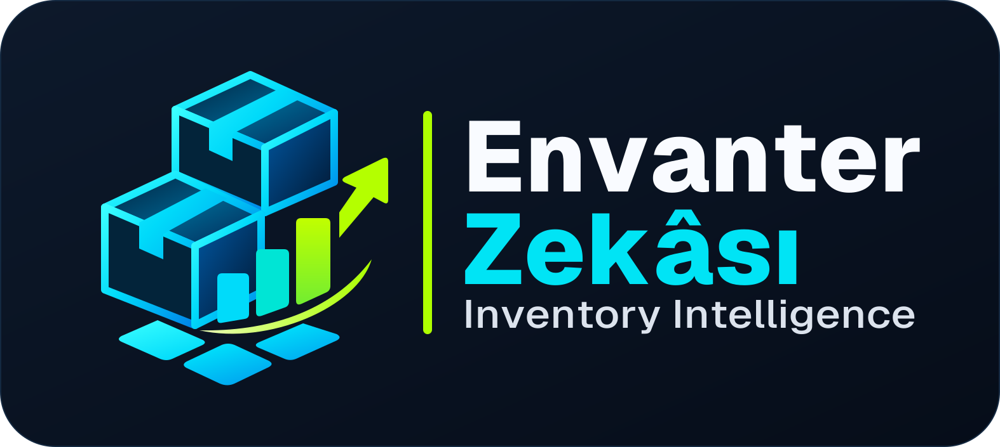
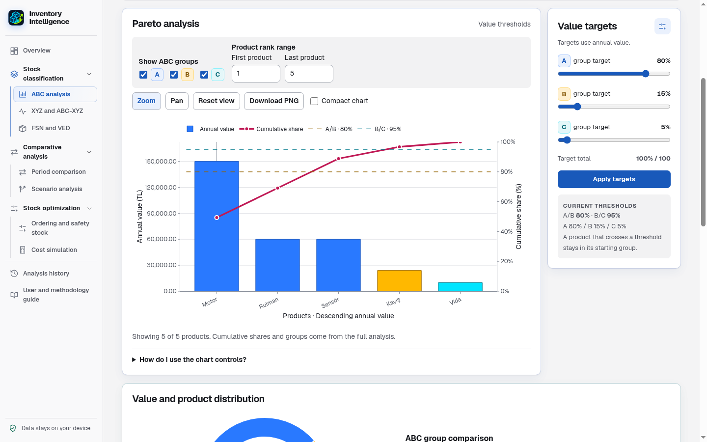

<picture>
  <source media="(prefers-color-scheme: light)" srcset="vercel-app/public/brand-logo-light.svg" />
  
</picture>

# Envanter Zekâsı

**Bütünleşik Stok Karar Destek Sistemi**

Stok değerini, talep değişkenliğini ve ikmal politikalarını tarayıcıda inceleyin. Excel veya CSV dosyasıyla başlayın ya da uygulamanın sentetik örnek verisini açın.

[Canlı uygulama](https://abc-inventory-analysis.vercel.app) · [English](README.en.md) · [Teknik kılavuz](vercel-app/README.md) · [Sürüm notları](CHANGELOG.md)
[Tam logo](vercel-app/public/brand-logo-full.svg) · [Şeffaf](vercel-app/public/brand-logo-transparent.svg) · [Açık tema](vercel-app/public/brand-logo-light.svg) · [Koyu tema](vercel-app/public/brand-logo-dark.svg) · [Favicon](vercel-app/public/favicon.svg)

## Uygulamadan görüntüler




Görüntüler yerel üretim derlemesinde uygulamanın sentetik örnek verisiyle alındı.

## Analiz modülleri

| Modül | Kullanım |
| --- | --- |
| ABC ve Pareto | Yıllık parasal tüketim değerine göre ürünleri sıralayın. Grup paylarını ve kümülatif değeri inceleyin. |
| XYZ | Eşit dönemlerdeki talebin değişim katsayısıyla değişkenlik sınıfı belirleyin. |
| ABC-XYZ | Ekonomik önem ve talep değişkenliğini SKU veya ürün adı üzerinden dokuz hücreli matriste birleştirin. |
| Dönemsel karşılaştırma | Eşdeğer iki dönemin parasal farklarını, eklenen ve çıkan ürünleri ve sınıf geçişlerini izleyin. |
| Senaryo analizi | Aynı envantere alternatif ABC hedefleri uygulayın ve sınıf geçişlerini karşılaştırın. |
| EOQ | Yıllık ilgili maliyeti en aza indiren teorik sipariş miktarını ve maliyet eğrilerini görün. |
| Yeniden sipariş noktası | Tedarik süresindeki beklenen talep ve emniyet stokundan sipariş eşiğini hesaplayın. |
| Emniyet stoku | Sabit veya değişken tedarik süresi için normal model ya da gözlemlere dayalı ampirik model kullanın. |
| FSN | Pozitif stok çıkışı görülen dönemlerin sıklığına göre hareketi sınıflandırın. |
| VED | Operasyon ve güvenlik etkisine göre kritiklik düzeyi belirleyin ve gerekçesini kaydedin. |
| Stok maliyeti simülasyonu | Aynı talep serisinde sabit parti ve hedefe tamamlama politikalarının maliyetini ve karşılama oranını karşılaştırın. |

Uygulama ayrıca ABC Excel raporu, grafik görseli, sürümlü JSON paketi, isteğe bağlı yerel analiz geçmişi ve iki dilli yöntem rehberi sağlar.

## Mimari ve gizlilik

React ve TypeScript arayüzü Vite ile statik uygulamaya derlenir. Hesaplama modülleri kullanıcı arayüzünden ayrıdır. Web Worker’lar dosya işleme, ABC, dönem ve senaryo hesapları ile Excel raporlamayı yürütür. Plotly grafikleri, ExcelJS çalışma kitaplarını işler. GitHub Actions kalite kontrollerini çalıştırır.

Dosya ve analiz verileri tarayıcıda işlenir. Analiz geçmişine yalnızca açık kaydetme işlemiyle IndexedDB kaydı eklenir ve kayıtlar silinebilir. İndirmeler tarayıcıda oluşturulur. Kaynaklar aynı kökenden sunulur ve üretim güvenlik politikası uygulama ağ bağlantılarını kısıtlar.

- [Akademik doğrulama ve model sınırlamaları](ENGINEERING_VALIDATION.md)
- [Güvenlik denetimi ve doğrulama kapsamı](SECURITY_AUDIT.md)

## Yerel geliştirme

Node.js 24.x (en az 24.11.1) ve npm gerekir.

```sh
cd vercel-app
npm ci --ignore-scripts
npm run dev
```

```sh
npm test
npm run typecheck
npm run lint
npm run format:check
npm run build
npm run verify:production
npm audit
```

Yerel üretim çıktısını görmek için `npm run preview` çalıştırın.
