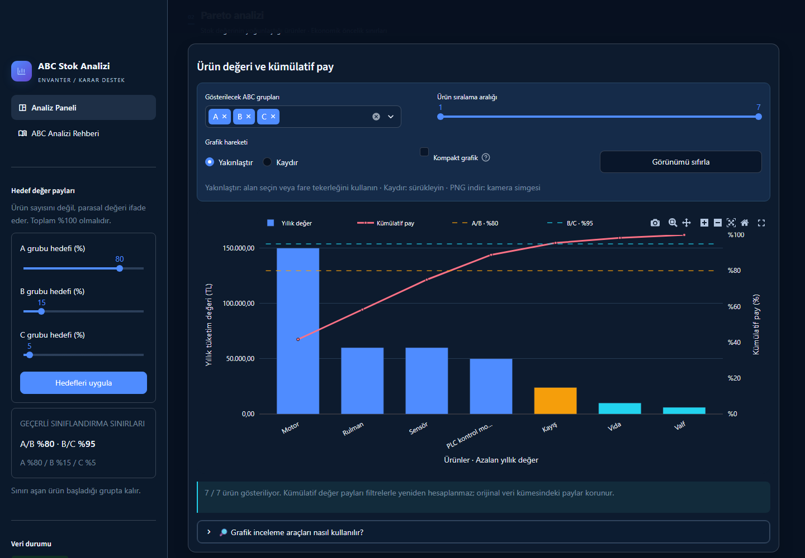

# ABC Stok Analiz Sistemi

**React ve TypeScript ile tarayıcıda çalışan stok önceliklendirme ve karar desteği.**

Excel veya CSV biçimindeki stok verilerinizi ABC sınıflandırmasına dönüştürün, yıllık tüketim değerini hangi ürünlerin oluşturduğunu inceleyin ve biçimlendirilmiş bir Excel raporu hazırlayın. Endüstri mühendisliği alanında bir portföy projesi olarak geliştirilen bu uygulama, etkileşimli analizi yöntemi açıklayan eğitici bir rehberle birleştirir.

**[Canlı uygulamayı aç](https://abc-inventory-analysis.vercel.app)** · **[GitHub deposunu incele](https://github.com/BarisDevLab/ABC-Inventory-Analysis)**

Güncel sürüm **React + TypeScript + Vite** altyapısıyla geliştirilmiş, **Vercel** üzerinde yayımlanan statik bir web uygulamasıdır. ABC hesaplamaları, CSV/Excel okuma ve Excel raporu üretimi tarayıcıda gerçekleşir; kullanıcı dosyaları analiz amacıyla sunucuya gönderilmez. Python/Streamlit sürümü, geçmiş uygulama ve hesaplama referansı olarak depoda korunur.

Arayüz ve öğrenme rehberi **Türkçedir**; Türkçe sayı biçimleri kullanılır ve fiyatlar Türk lirası (TL) cinsinden gösterilir. Dosya hazırlamadan uygulamayı incelemek için canlı uygulamayı açıp hazır örnek veri setini yükleyen **Örnek veriyle dene** seçeneğini kullanın.

## Özellikler

- **Excel ve CSV yükleme:** `.xlsx` veya `.csv` dosyası yükleyin, boş Excel şablonunu indirin ya da uygulamanın örnek veri setini kendi seçiminizle yükleyin.
- **Veri doğrulama:** Eksik sütunlar, boş alanlar, yinelenen ürünler, geçersiz sayılar ve negatif tüketim miktarları veya fiyatlar reddedilir. Toplam yıllık değer sıfırdan büyük olmalıdır.
- **Ayarlanabilir sınıflandırma:** A, B ve C gruplarının hedef değer paylarını değiştirin; toplamlarının %100 olduğu doğrulanır.
- **Stok özeti:** Altı temel performans göstergesi (KPI) kartında toplam yıllık değer, ürün sayısı, A grubunun gerçekleşen değer payı ve A/B/C gruplarının ürün sayıları gösterilir.
- **Etkileşimli Pareto analizi:** Gruba veya ürün sıralama aralığına göre filtreleyin; yakınlaştırın, kaydırın, görünümü sıfırlayın, kompakt grafiğe geçin ve PNG indirin. Bilgi kutuları tüketim miktarını, birim fiyatı, yıllık değeri, değer payını, kümülatif payı ve grubu gösterir.
- **Karar desteği:** Grup dağılımını, ürün ve grup tablolarını; en yüksek değerli ürün, ilk üç ürünün toplam değer payı ve A grubundaki yoğunlaşma hakkında veriden hesaplanan özetleri inceleyin.
- **Excel raporlama:** Ürün bazlı sonuçları, grup özetini ve uygulanan sınıflandırma hedeflerini biçimlendirilmiş bir Excel çalışma kitabına aktarın.
- **ABC öğrenme rehberi:** Formülleri, beş hesaplama adımını, iki çözümlü örneği, mühendislik uygulamalarını ve yöntemin sınırlamalarını dört sekmede inceleyin.

Yüklenen veriler ve uygulanan hedefler, analiz paneli ile rehber arasında geçiş yaparken **React belleğinde** korunur. Dosya içeriği kalıcı tarayıcı depolamasına yazılmaz; sayfa yenilendiğinde veya yeni sekme açıldığında analiz sıfırlanır. İlk açılışta demo kendiliğinden yüklenmez. Dosya işleme, yeniden hesaplama ve Excel raporlama için Web Worker kullanılır; büyük sonuç tabloları 50 satırlık sayfalarda gösterilir. Excel raporu, Pareto filtrelerinden ve tablo sayfalamasından bağımsız olarak tüm ürünleri içerir.

## Ekran görüntüleri

Görüntüler, önceki Streamlit sürümünün örnek stok verileriyle yapılan yerel Chrome testlerinden korunmuştur; güncel React arayüzünün birebir ekran görüntüleri değildir. Bu depoda saklanırlar ve harici bir görsel barındırma hizmetine bağlı değildirler. Güncel arayüzü [canlı uygulamada](https://abc-inventory-analysis.vercel.app) inceleyebilirsiniz.

### Analiz paneli

Ortak koyu arayüzde veri yükleme, sınıflandırma hedefleri ve stok performans göstergeleri.


### Pareto analizi

Yıllık değerleri, kümülatif değer payını, grup eşiklerini ve grafik kontrollerini gösteren yedi ürünlü örnek.



### ABC öğrenme rehberi

Yöntem, hesaplamalar, çözümlü örnekler ve mühendislik uygulamaları için konu panelleri ve sekmeler içeren ayrı öğrenme alanı.


## Kullanılan teknolojiler

| Teknoloji | Kullanım amacı |
|---|---|
| **React** | Bileşen tabanlı Türkçe arayüz, gezinme ve bellek içi veri durumu |
| **TypeScript** | Saf ABC hesaplama çekirdeği, doğrulama ve tür güvenliği |
| **Vite** | Yerel geliştirme ve statik üretim derlemesi |
| **Vercel** | Güncel React uygulamasının barındırılması ve GitHub bağlantılı dağıtımı |
| **Plotly** | Etkileşimli Pareto ve dağılım grafikleri, bilgi kutuları ve PNG dışa aktarma |
| **ExcelJS** | Tarayıcıda XLSX okuma, biçimlendirilmiş rapor ve boş şablon üretimi |
| **Vitest ve Testing Library** | Çekirdek, dosya, rapor ve React entegrasyon testleri |
| **Python, Pandas ve openpyxl** | Korunan Python sürümü, karşılaştırmalı hesaplama ve bağımsız Excel doğrulaması |
| **Streamlit** | Depoda korunan önceki web uygulaması |

Matplotlib, `main.py` içindeki bağımsız konsol örneği için korunmuştur; web uygulamasının grafikleri Plotly ile oluşturulur.

## Yerel kurulum ve çalıştırma

### Güncel React sürümü

**Node.js 24.11.1 veya üzeri bir 24.x sürümü** ve npm kullanın. Kilitli bağımlılıkları geliştirme bağımlılıklarıyla birlikte kurun:

```bash
git clone https://github.com/BarisDevLab/ABC-Inventory-Analysis.git
cd ABC-Inventory-Analysis/vercel-app
npm ci
npm run dev
```

Vite'ın terminalde gösterdiği adresi açın. Üretim çıktısını yerel olarak kontrol etmek için:

```bash
npm run build
npm run preview
```

`predev` ve `prebuild` adımları güvenli ExcelJS tarayıcı paketini kaynaklardan üretir; üretilen dosyalar Git'e eklenmez. Vercel ayarları: **Root Directory `vercel-app`**, **Vite**, **Node.js 24.x**, kurulum **`npm ci`**, derleme **`npm run build`**, çıktı **`dist`**. Ayrıntılar ve uyumluluk sınırları için [React sürümü belgelerine](vercel-app/README.md) bakın.

### Korunan Python/Streamlit sürümü

Yerel doğrulamada kullanılan Python **3.12** sürümüyle birlikte pip paket yöneticisini kullanın. Bağımlılık sürüm aralıkları [`requirements.txt`](requirements.txt) dosyasında tanımlıdır.

#### 1. Depoyu klonlayın ve sanal ortam oluşturun

```bash
git clone https://github.com/BarisDevLab/ABC-Inventory-Analysis.git
cd ABC-Inventory-Analysis
python -m venv .venv
```

Sisteminizde Python'a `python3` komutuyla erişiliyorsa `python` yerine `python3` kullanın.

#### 2. Sanal ortamı etkinleştirin

Windows PowerShell:

```powershell
.\.venv\Scripts\Activate.ps1
```

macOS / Linux:

```bash
source .venv/bin/activate
```

#### 3. Bağımlılıkları yükleyin ve Streamlit'i başlatın

```bash
python -m pip install -r requirements.txt
python -m streamlit run app.py
```

Streamlit'in terminalde gösterdiği yerel adresi açın. **Önceki Streamlit uygulamasının giriş dosyası `app.py` dosyasıdır**; güncel React sürümü `vercel-app/` altındadır. `main.py` ayrı bir konsol/Matplotlib örneğidir.

## Kullanım

1. **Verilerinizi hazırlayın.** Boş Excel şablonunu indirin veya aşağıdaki sütun başlıklarını aynen kullanın. Alternatif olarak **Örnek veriyle dene** seçeneğiyle hazır örneği inceleyin.
2. **Dosya yükleyin.** Analiz panelinin veri çalışma alanından bir Excel veya CSV dosyası seçin.
3. **Hedefleri belirleyin.** Sol menüde A/B/C değer paylarını ayarlayın ve **Hedefleri uygula** düğmesine basın. Toplam %100 olmalıdır.
4. **Sonuçları inceleyin.** Performans göstergelerini ve tabloları gözden geçirin, Pareto grafiğini filtreleyin ve ürünleri tek tek inceleyin. Dar ekranlarda kompakt görünümü kullanın.
5. **Dışa aktarın veya ayrıntıları öğrenin.** Excel raporunu ya da grafiği PNG olarak indirin. Yöntem ve çözümlü örnekler için **ABC Analizi Rehberi** sayfasını açın.

### Veri biçimi

Aşağıdaki Türkçe sütun adlarını değiştirmeden kullanın:

| Ürün | Yıllık Tüketim | Birim Fiyat (TL) |
|---|---:|---:|
| Motor | 100 | 1500 |
| Rulman | 500 | 120 |
| Sensör | 150 | 400 |
| Kayış | 300 | 80 |
| Vida | 2000 | 5 |

- Her ürün tek satırda yer almalıdır. Tüketim miktarları ve fiyatlar sonlu, negatif olmayan sayılar olmalıdır.
- CSV dosyalarında UTF-8 ve Windows Türkçe kodlamaları; virgül, noktalı virgül veya sekme ayraçları desteklenir.
- Ondalık sayı örnekleri: `1234.56` veya `1.234,56`. Tek başına kullanılan virgül veya nokta ondalık ayracı kabul edilir: `1,234`, **1.234** anlamına gelir; bin iki yüz otuz dört birim anlamına gelmez. Binlik gruplama için `1 234` veya `1.234,00` kullanın. Excel'de sayısal hücreler kullanmak bu belirsizliği önler.

## ABC sınıflandırması nasıl çalışır?

Her ürün için:

```text
Yıllık tüketim değeri = Yıllık tüketim miktarı × Birim fiyat
Değer payı (%) = Ürünün yıllık değeri / Toplam yıllık değer × 100
```

Ürünler, yıllık tüketim değeri en yüksek olandan en düşük olana doğru sıralanır. Eşit değerli ürünlerde giriş sırası korunur. Varsayılan hedefler ürün sayısını değil, **yıllık parasal değeri** böler:

| Grup | Hedef değer payı | Varsayılan kümülatif sınır |
|---|---:|---:|
| A | %80 | %80 |
| B | %15 | %95 |
| C | %5 | %100'e kadar kalan değer |

Sınıflandırmada her ürünün değer payı eklenmeden **önceki** kümülatif pay kullanılır. Eşiği aşan ürün, başladığı grupta kalır; sıfır değerli ürünler C grubuna atanır. Ürünler bölünmediği için gerçekleşen grup payları hedeflerden farklı olabilir.

Pareto filtreleri, tam analizdeki kümülatif yüzdeleri korur; sınıflandırmayı yeniden hesaplamaz. Dağılım grafiği, sonuç tabloları ve Excel raporu veri kümesinin tamamını göstermeye devam eder.

ABC analizi ekonomik önemi ölçer. Stok kararlarında tedarik süreleri, talep değişkenliği ve operasyonel kritiklik de değerlendirilmelidir.

## Proje yapısı

```text
vercel-app/                 # Güncel React + TypeScript + Vite uygulaması
  src/core/                 # Python referanslarıyla karşılaştırılan ABC çekirdeği
  src/io/                   # Tarayıcıda CSV/XLSX okuma ve doğrulama
  src/export/               # Excel raporu, şablon ve indirme worker'ı
  src/components/           # Analiz paneli, tablolar ve dört sekmeli rehber
  src/charts/               # Plotly grafikleri ve etkileşimleri
  tests/                    # Otomatik testler ve sentetik referans veriler
  scripts/                  # ExcelJS derlemesi ve doğrulama araçları
  package-lock.json         # Kilitli npm bağımlılıkları
app.py                      # Streamlit analiz paneli ve oturum akışı
abc_core.py                 # Veri doğrulama, sınıflandırma, yorumlar ve Excel çıktısı
abc_charts.py               # Plotly grafikleri ve grafik ayarları
ui.py                       # Ortak arayüz bileşenleri
pages/1_ABC_Rehberi.py       # ABC öğrenme rehberi
assets/theme.css            # Ortak duyarlı tema
assets/screenshots/         # Depoda saklanan ekran görüntüleri
.streamlit/config.toml      # Streamlit tema ayarları
test_app.py                 # Birim testleri ve Streamlit entegrasyon testleri
requirements.txt            # Çalışma zamanı bağımlılıkları
main.py                     # Bağımsız konsol/Matplotlib örneği
```

## Test ve doğrulama

### Güncel React sürümü — 25 Kasım 2026

Depo dizin yapısını koruyarak `vercel-app/` içinde çalıştırın; üç referans testi üst klasördeki `abc_core.py` dosyasının kaynak hash'ini de doğrular:

```bash
cd vercel-app
npm ci
npm test
npm run typecheck
npm run build
```

| Kontrol | Doğrulanmış sonuç |
|---|---|
| Temiz kurulum ve ExcelJS paketinin yeniden üretimi | Başarılı; paket ve lisans çıktılarının SHA-256 değerleri eşleşti |
| Otomatik testler | **299 başarılı, 0 başarısız** |
| TypeScript kontrolü ve Vite üretim derlemesi | Başarılı |
| Bağımsız Excel doğrulaması | **17 dosya başarılı** |
| Canlı uygulamada gerçek Chrome kontrolleri | **48 başarılı, 0 hata** |
| GitHub Actions Python kontrolleri | Başarılı |
| Vercel otomatik dağıtımı | Başarılı |

Otomatik testler; Python referanslarıyla ABC hesaplamalarını, sınır değerlerini, Türkçe sayı/karakter işlemlerini, CSV/XLSX doğrulamasını, Excel raporu ve formül güvenliğini, React akışlarını ve grafik yaşam döngüsünü kapsar. Canlı Chrome kontrollerinde ABC analizi, hedefler, filtreleme, yakınlaştırma/kaydırma/sıfırlama, dört rehber sekmesi, sayfalar arası veri korunması, masaüstü/tablet/mobil emülasyon ve gerçek Excel/PNG indirmeleri sınandı. Canlıdan indirilen raporda üç sayfa, beş ürün, 304.000 TL toplam ve %80/%15/%5 hedefleri ayrıca doğrulandı; boş şablon yalnızca başlıklardan oluştu.

5.000 ürünlük yerel ölçümde en uzun ana iş parçacığı görevi **498 ms'den 147 ms'ye**, dosyadan grafiğe süre **1.075 ms'den 259 ms'ye** düştü. Bunlar cihazlar arası performans garantisi değildir. Mobil emülasyon gerçek telefon/Safari testinin yerini tutmaz. Üretim bağımlılıklarının son npm taramasında bildirim yoktur; geliştirme araç zincirinde uygulama paketine girmeyen **dört düşük seviyeli bildirim** ve Vite'ın büyük parça uyarısı sürer. Bilinen beş dosya davranışı farkı, LF/CRLF kaynak-hash sınırı ve ayrıntılı sonuçlar [React README'sinde](vercel-app/README.md) belgelenmiştir.

### Korunan Python/Streamlit testleri

Mevcut test paketini proje kök klasöründe çalıştırın:

```bash
python -m unittest test_app -v
```

Test paketi; sınıflandırma sınırlarını, geçersiz girdileri, CSV/Excel işlemlerini, çalışma kitabı çıktılarını, grafik verilerinin bütünlüğünü, modül içe aktarımlarını ve Streamlit'in sayfa geçişi/oturum davranışını kapsayan **44 test** içerir.

Önceki yerel Chrome kontrollerinde masaüstü ve mobil emülasyon, yedi ürünlü ve 60 ürünlü veri kümeleri, küçük değerler, klavye odağı, filtreleme, yakınlaştırma, kaydırma, sıfırlama ve PNG indirme de incelenmiştir. Mobil emülasyon, gerçek cihazlarda veya diğer tarayıcılarda yapılan testlerin yerini tutmaz. Kapsam ve sınırlamalar için [ayrıntılı doğrulama raporunu](TEST_SONUCLARI.md) inceleyin.

---

**[BarisDevLab](https://github.com/BarisDevLab)** tarafından bir endüstri mühendisliği portföy projesi olarak geliştirilmiştir.
